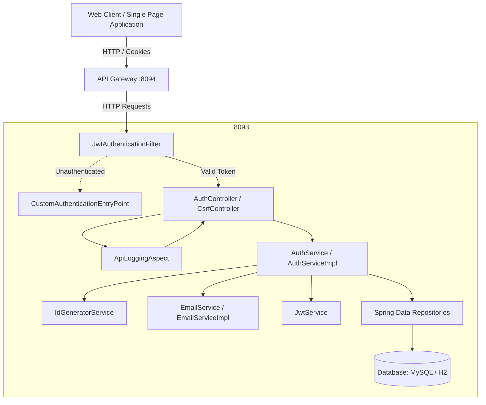
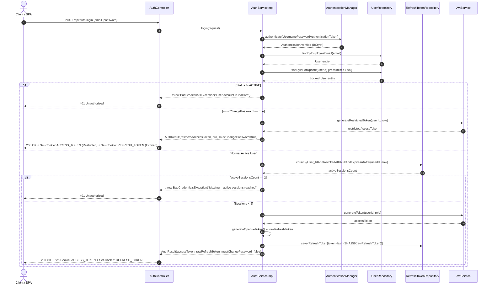
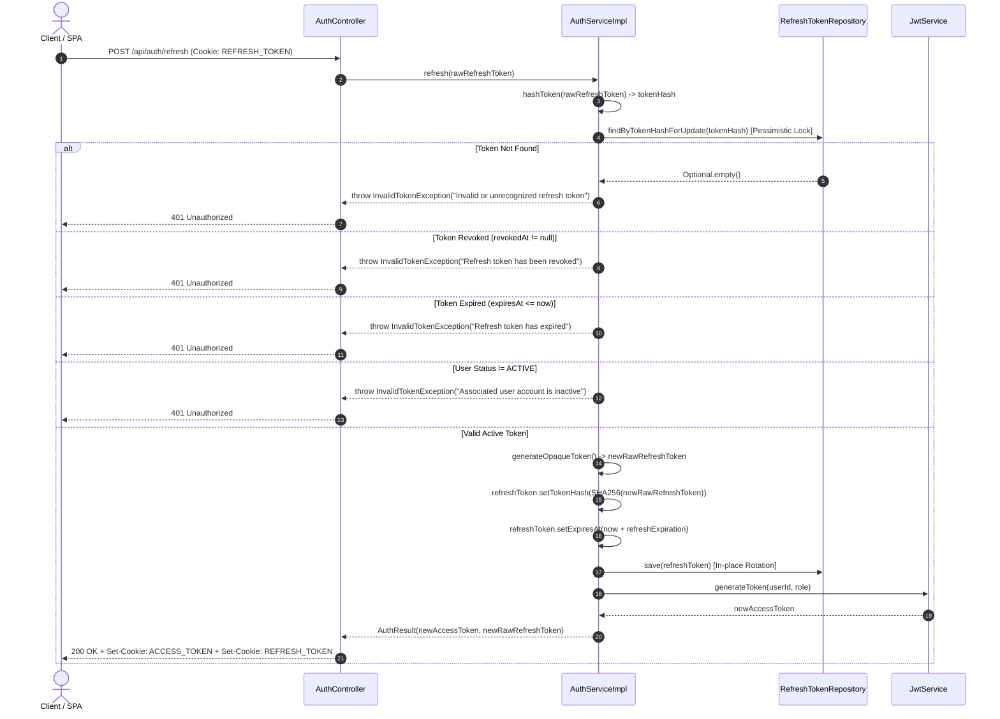
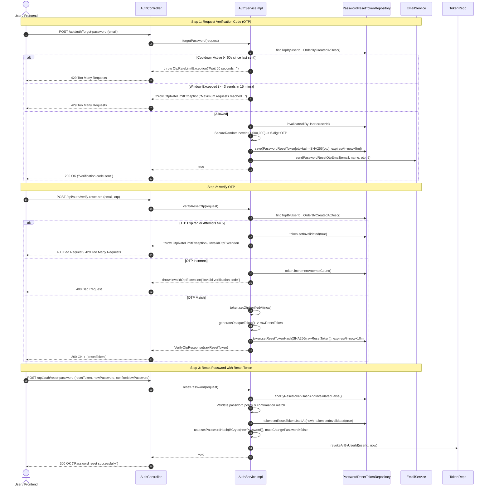
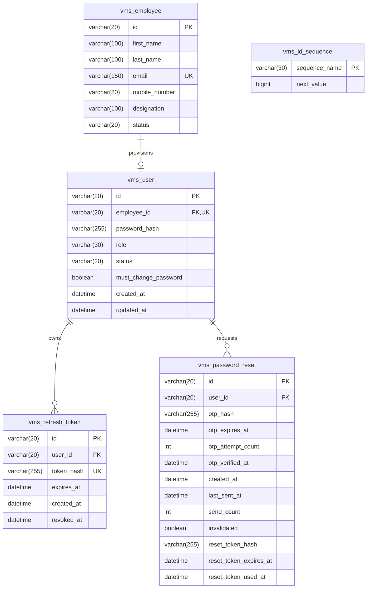

# Auth/Security Application Technical Documentation

## Table of Contents
1. [Project Overview and System Role](#1-project-overview-and-system-role)
2. [Technology Stack and Dependencies](#2-technology-stack-and-dependencies)
3. [Architecture and System Design](#3-architecture-and-system-design)
4. [Package and Class Technical Reference](#4-package-and-class-technical-reference)
5. [Complete REST API Specification](#5-complete-rest-api-specification)
6. [Authentication and Session Flows](#6-authentication-and-session-flows)
7. [Password Reset and OTP Lifecycle](#7-password-reset-and-otp-lifecycle)
8. [Database Schema and Persistence Model](#8-database-schema-and-persistence-model)
9. [Configuration and Environment Setup](#9-configuration-and-environment-setup)
10. [Error Handling, Validation, and Observability](#10-error-handling-validation-and-observability)
11. [Testing Architecture and Test Suite Reference](#11-testing-architecture-and-test-suite-reference)
12. [Developer and Maintainer Guide](#12-developer-and-maintainer-guide)

---

## 1. Project Overview and System Role

### 1.1 Purpose and Context
The **Auth/Security Application** (`com.adminvisitor:auth`) is the dedicated authentication, authorization, and identity-management microservice for the **Visitor Management System (VMS)**. In an enterprise facility access control system, security is paramount: receptionists, security guards, administrators, and hosts must be securely identified, access must be partitioned strictly along role boundaries, and session lifecycles must be rigorously governed.

The Auth service acts as the central security authority. It decouples identity verification, credential storage, cryptographic token issuance, and session governance from downstream business services (such as Visitor Registration, Badge Printing, and Host Notifications).

### 1.2 Core Responsibilities and Ownership Boundaries
The application strictly owns and manages:
- **User Identity Governance:** Storage and lifecycle management of user credentials, account activation statuses (`ACTIVE`, `INACTIVE`), and role assignments (`ADMIN`, `HR`).
- **Credential Verification:** Secure, slow-hash password matching via BCrypt.
- **Asymmetric Token Issuance and Verification:** Creation and cryptographic signature validation of RS256 JSON Web Tokens (JWT).
- **Session Governance:** Refresh token issuance, database persistence, row-locked rotation, concurrent session limitation (maximum 2 active sessions per user), and revocation.
- **Browser Cookie Management:** Secure delivery of access and refresh tokens through `HttpOnly`, `SameSite=Lax` cookies.
- **First-Login Policy Enforcement:** Issuance of restricted access tokens requiring initial password changes before granting standard permissions.
- **Self-Service Password Reset:** Time-bounded, rate-limited 6-digit numeric OTP generation, verification, and reset authorization token issuance.
- **Onboarding Communication:** Asynchronous HTML email dispatch with temporary credentials for newly provisioned personnel.
- **Deterministic ID Generation:** Pessimistically locked sequence management (`vms_id_sequence`) for formatted identifiers (e.g., `USR-001`, `PRT_001`).

### 1.3 External System Interactions
Based on the codebase, the service interacts with the following boundaries:
1. **Relational Database (MySQL / H2 for Tests):** Owns tables `vms_user`, `vms_refresh_token`, `vms_password_reset`, and `vms_id_sequence`. Interacts directly with `vms_employee` for employee profile association.
2. **API Gateway (`http://localhost:8094`):** Documented in `OpenApiConfig` and permitted in CORS. The gateway acts as the reverse proxy routing client requests to the Auth service.
3. **Frontend Client Applications (`http://localhost:4200`):** Permitted origin for Single Page Applications (Angular/React).
4. **SMTP Mail Server (`smtp.gmail.com:587`):** Dispatches onboarding credentials and password-reset OTP emails over TLS.

### 1.4 System Boundaries and Limitations
- **No Public Self-Registration:** There is no public user registration endpoint. Users can only be created by an authenticated `ADMIN` through `POST /api/auth/users` for an existing, active employee.
- **Direct Database Shared Read of `vms_employee`:** The application reads employee records directly from the database table `vms_employee` rather than consuming an Employee REST API.
- **Stateless Access / Stateful Refresh Hybrid:** Access tokens are stateless JWTs validated locally, but refresh tokens and account statuses are checked against the database on each refresh and filter execution.

---

## 2. Technology Stack and Dependencies

The technology stack is configured via [pom.xml](file:///c:/Users/logeshwaran.j/Downloads/auth/auth/pom.xml).

| Technology / Library | Version | Project Scope | Role and Usage in Application |
| :--- | :--- | :--- | :--- |
| **Java** | 21+ (compiled on JDK 25) | Core Runtime | Base programming language utilizing modern records, switch expressions, and pattern matching. |
| **Spring Boot** | 4.1.1 (Starter Parent) | Framework | Dependency injection, auto-configuration, application lifecycle, and embedded Tomcat runtime. |
| **Spring Security** | Managed by Boot | Security Core | Filter chain orchestration, method-level security (`@EnableMethodSecurity`), authorization rules, and session policies. |
| **Spring Web MVC** | Managed by Boot | REST Controllers | HTTP request routing, JSON request/response marshaling, parameter binding, and content negotiation. |
| **Spring Data JPA / Hibernate** | 7.4.5 (Managed) | Persistence | Object-Relational Mapping (ORM), repository abstraction, and transactional query execution. |
| **MySQL Connector/J** | Managed | Runtime DB Driver | Production JDBC driver communicating with MySQL database. |
| **H2 Database** | Managed | Test DB Driver | Fast in-memory relational database running in MySQL compatibility mode for unit and integration testing. |
| **JJWT (Java JWT)** | 0.12.6 (`api`, `impl`, `jackson`) | Token Engine | Asymmetric RSA (RS256) JWT creation, claim signing, parsing, and expiration validation. |
| **Spring Boot Mail** | Managed | Email Engine | `JavaMailSender` abstraction for sending multi-part MIME emails over SMTP. |
| **Thymeleaf** | Managed | Templating Engine | Server-side template rendering for `onboarding-email.html` and `password-reset-email.html`. |
| **AspectJ / Spring AOP** | Managed | Cross-Cutting | Aspect-oriented programming intercepting controller endpoints for execution timing logs. |
| **Spring Validation** | Managed (Hibernate Validator 9.1.3) | DTO Validation | Jakarta Bean Validation (`@NotBlank`, `@Email`, `@NotNull`) on request DTOs. |
| **MapStruct** | 1.6.3 | Code Generation | High-performance, type-safe compile-time bean mapping between `User` entities and `UserResponse` DTOs. |
| **Project Lombok** | Managed | Boilerplate Reduction | Compile-time generation of getters, setters, and constructors (`@Getter`, `@Setter`, `@RequiredArgsConstructor`). |
| **SpringDoc OpenAPI** | 3.1.1 (`webmvc-ui`) | API Docs | Automated OpenAPI 3 spec generation and Swagger UI hosted at `/v3/api-docs` and `/swagger-ui.html`. |
| **Micrometer / OpenTelemetry** | Managed | Distributed Tracing | Trace and span generation, providing trace IDs via `TraceIdProvider` for error responses. |
| **Logstash Logback Encoder** | 8.1 | Logging | Structured JSON log generation for central log aggregators. |
| **JUnit 5 (Jupiter)** | Managed | Test Framework | Execution engine for unit tests, parameterization, and assertions. |
| **Mockito** | Managed | Mocking Framework | Test spy and mock generation for isolated unit testing. |

---

## 3. Architecture and System Design

### 3.1 Layered Architecture Pattern
The Auth application is designed following classic layered architectural principles:



1. **Security Layer (`com.adminvisitor.auth.security`, `com.adminvisitor.auth.config`):** Intercepts incoming HTTP requests before reaching controllers. Extracts access token from cookies, validates JWT cryptographic signatures, queries user account status, and populates Spring's `SecurityContext`.
2. **Controller Layer (`com.adminvisitor.auth.controller`):** Exposes REST endpoints, validates incoming JSON DTO payloads via `@Valid`, manages `HttpOnly` cookie generation, and maps service domain results to HTTP responses.
3. **Aspect Layer (`com.adminvisitor.auth.config`):** `ApiLoggingAspect` wraps all `@RestController` executions, measuring elapsed execution milliseconds and writing structured logs.
4. **Service Layer (`com.adminvisitor.auth.service.Impl`):** Orchestrates business transactions, enforces password policies, performs row-locked credential and token checks, generates opaque tokens, and triggers emails.
5. **Data Access Layer (`com.adminvisitor.auth.repository`):** Spring Data JPA interfaces executing database queries with explicit pessimistic write locking (`@Lock(LockModeType.PESSIMISTIC_WRITE)`) where race conditions could arise.
6. **Entity / Persistence Model (`com.adminvisitor.auth.entity`):** JPA entities mapping relational tables in the database.

---

### 3.2 Core Sequence Diagrams

#### 3.2.1 User Login Sequence Flow


#### 3.2.2 Refresh Token Rotation Flow


#### 3.2.3 Password Reset and OTP Flow


---

## 4. Package and Class Technical Reference

### 4.1 Package `com.adminvisitor.auth`
- **[AuthApplication.java](file:///c:/Users/logeshwaran.j/Downloads/auth/auth/src/main/java/com/adminvisitor/auth/AuthApplication.java):**
  - **Annotation:** `@SpringBootApplication`, `@EnableAsync`.
  - **Responsibility:** Main bootstrap class initializing Spring application context, embedded Tomcat server, and background asynchronous task executors.

### 4.2 Package `com.adminvisitor.auth.config`
- **[SecurityConfig.java](file:///c:/Users/logeshwaran.j/Downloads/auth/auth/src/main/java/com/adminvisitor/auth/config/SecurityConfig.java):**
  - **Responsibility:** Configures Spring Security filter chains, authorization rules, password encoders, session policies, and CORS.
  - **Key Beans:**
    - `securityFilterChain(HttpSecurity http)`: Sets `SessionCreationPolicy.STATELESS`, configures `csrf.spa()`, defines URL matchers, and places `JwtAuthenticationFilter` before `UsernamePasswordAuthenticationFilter`.
    - `corsConfigurationSource()`: Maps allowed origins (`http://localhost:4200`, `http://localhost:8094`), HTTP verbs, headers, and credentials.
    - `passwordEncoder()`: Instantiates `new BCryptPasswordEncoder(12)`.
    - `authenticationManager()`: Exposes Spring's `AuthenticationManager` bean.
- **[ApiLoggingAspect.java](file:///c:/Users/logeshwaran.j/Downloads/auth/auth/src/main/java/com/adminvisitor/auth/config/ApiLoggingAspect.java):**
  - **Responsibility:** AOP aspect intercepting all `@RestController` beans.
  - **Method:** `logApiExecutionTime(ProceedingJoinPoint joinPoint)` logs `API_COMPLETED` with HTTP method, URI, and duration in milliseconds, or `API_EXECUTION_INTERRUPTED` if an exception is thrown.
- **[AsyncConfig.java](file:///c:/Users/logeshwaran.j/Downloads/auth/auth/src/main/java/com/adminvisitor/auth/config/AsyncConfig.java):**
  - **Responsibility:** Implements `AsyncConfigurer` to capture unhandled exceptions in asynchronous methods (`@Async` on email delivery) and log them with context.
- **[OpenApiConfig.java](file:///c:/Users/logeshwaran.j/Downloads/auth/auth/src/main/java/com/adminvisitor/auth/config/OpenApiConfig.java):**
  - **Responsibility:** Registers OpenAPI definition specifying `http://localhost:8094` (API Gateway) as the primary server target for generated API documentation.

### 4.3 Package `com.adminvisitor.auth.controller`
- **[AuthController.java](file:///c:/Users/logeshwaran.j/Downloads/auth/auth/src/main/java/com/adminvisitor/auth/controller/AuthController.java):**
  - **Responsibility:** Primary REST controller exposing endpoints under `/api/auth`.
  - **Endpoints Handled:**
    - `POST /api/auth/login`: Handles login, attaches `ACCESS_TOKEN` and conditional `REFRESH_TOKEN` cookies.
    - `POST /api/auth/users`: Provisioning endpoint secured with `@PreAuthorize("hasRole('ADMIN')")`.
    - `POST /api/auth/change-password`: Changes password for authenticated or restricted-token users.
    - `POST /api/auth/forgot-password`: Triggers OTP dispatch.
    - `POST /api/auth/forgot-password/resend`: Resends OTP under rate limits.
    - `POST /api/auth/verify-reset-otp`: Verifies OTP and returns opaque reset token.
    - `POST /api/auth/reset-password`: Resets password using validated reset token.
    - `POST /api/auth/refresh`: Rotates refresh token from cookie and updates session cookies.
    - `POST /api/auth/logout`: Revokes refresh token in database and returns clearing cookies (`Max-Age=0`).
- **[CsrfController.java](file:///c:/Users/logeshwaran.j/Downloads/auth/auth/src/main/java/com/adminvisitor/auth/controller/CsrfController.java):**
  - **Responsibility:** Endpoint `GET /api/auth/csrf` invoking `CsrfToken.getToken()` to force evaluation and issuance of CSRF tokens to Single Page Applications.

### 4.4 Package `com.adminvisitor.auth.security`
- **[JwtAuthenticationFilter.java](file:///c:/Users/logeshwaran.j/Downloads/auth/auth/src/main/java/com/adminvisitor/auth/security/JwtAuthenticationFilter.java):**
  - **Responsibility:** `OncePerRequestFilter` extracting `ACCESS_TOKEN` cookie. Validates token signature and expiration, verifies user existence and active status in DB (`userRepository.existsByIdAndStatus`), maps token `state` (`AUTHENTICATED` vs `INITIAL_PASSWORD_CHANGE_REQUIRED`) to GrantedAuthorities, and sets the `Authentication` in `SecurityContextHolder`.
- **[JwtService.java](file:///c:/Users/logeshwaran.j/Downloads/auth/auth/src/main/java/com/adminvisitor/auth/security/JwtService.java):**
  - **Responsibility:** Cryptographic JWT engine using RSA (RS256).
  - **Key Operations:** Loads PKCS#8 private key from disk to sign tokens; loads X.509 public key from disk to parse and verify signatures. Issues standard tokens (`generateToken`) and restricted first-login tokens (`generateRestrictedToken`).
- **[CustomAuthenticationEntryPoint.java](file:///c:/Users/logeshwaran.j/Downloads/auth/auth/src/main/java/com/adminvisitor/auth/security/CustomAuthenticationEntryPoint.java):**
  - **Responsibility:** Handles unauthenticated requests rejected by Spring Security filter chain. Writes a direct JSON error response with status 401.
- **[CustomUserDetailsService.java](file:///c:/Users/logeshwaran.j/Downloads/auth/auth/src/main/java/com/adminvisitor/auth/security/CustomUserDetailsService.java):**
  - **Responsibility:** Implements Spring Security's `UserDetailsService`. Looks up user by employee email via `userRepository.findByEmployeeEmail(email)` and converts it to a Spring Security `UserDetails` object with user ID as username and hashed password.

### 4.5 Package `com.adminvisitor.auth.service` and `com.adminvisitor.auth.service.Impl`
- **[AuthService.java](file:///c:/Users/logeshwaran.j/Downloads/auth/auth/src/main/java/com/adminvisitor/auth/service/AuthService.java) & [AuthServiceImpl.java](file:///c:/Users/logeshwaran.j/Downloads/auth/auth/src/main/java/com/adminvisitor/auth/service/Impl/AuthServiceImpl.java):**
  - **Responsibility:** Core business logic for authentication, user creation, session rotation, password policy verification, and password recovery.
- **[EmailService.java](file:///c:/Users/logeshwaran.j/Downloads/auth/auth/src/main/java/com/adminvisitor/auth/service/EmailService.java) & [EmailServiceImpl.java](file:///c:/Users/logeshwaran.j/Downloads/auth/auth/src/main/java/com/adminvisitor/auth/service/Impl/EmailServiceImpl.java):**
  - **Responsibility:** Asynchronous email dispatch using Thymeleaf HTML templates.
- **[IdGeneratorService.java](file:///c:/Users/logeshwaran.j/Downloads/auth/auth/src/main/java/com/adminvisitor/auth/service/IdGeneratorService.java) & [IdGeneratorServiceImpl.java](file:///c:/Users/logeshwaran.j/Downloads/auth/auth/src/main/java/com/adminvisitor/auth/service/Impl/IdGeneratorServiceImpl.java):**
  - **Responsibility:** Thread-safe, pessimistic-locked sequence incrementation generating human-readable IDs (`USR-001`, `PRT_001`).

### 4.6 Package `com.adminvisitor.auth.repository`
- **[UserRepository.java](file:///c:/Users/logeshwaran.j/Downloads/auth/auth/src/main/java/com/adminvisitor/auth/repository/UserRepository.java):** JPA queries for `User`, including email lookup, status check, and pessimistic locking query `findByIdForUpdate`.
- **[EmployeeRepository.java](file:///c:/Users/logeshwaran.j/Downloads/auth/auth/src/main/java/com/adminvisitor/auth/repository/EmployeeRepository.java):** Access to `Employee` records.
- **[RefreshTokenRepository.java](file:///c:/Users/logeshwaran.j/Downloads/auth/auth/src/main/java/com/adminvisitor/auth/repository/RefreshTokenRepository.java):** Token hash lookups, session counting, bulk revocation (`revokeAllByUserId`), and pessimistic locking query `findByTokenHashForUpdate`.
- **[PasswordResetTokenRepository.java](file:///c:/Users/logeshwaran.j/Downloads/auth/auth/src/main/java/com/adminvisitor/auth/repository/PasswordResetTokenRepository.java):** Latest active OTP token retrieval, 15-minute rate limit counting, bulk invalidation, and reset token hash lookup.
- **[IdSequenceRepository.java](file:///c:/Users/logeshwaran.j/Downloads/auth/auth/src/main/java/com/adminvisitor/auth/repository/IdSequenceRepository.java):** Pessimistic row locking on sequence counter row.

### 4.7 Package `com.adminvisitor.auth.entity`
- **[User.java](file:///c:/Users/logeshwaran.j/Downloads/auth/auth/src/main/java/com/adminvisitor/auth/entity/User.java):** Maps `vms_user`.
- **[Employee.java](file:///c:/Users/logeshwaran.j/Downloads/auth/auth/src/main/java/com/adminvisitor/auth/entity/Employee.java):** Maps `vms_employee`.
- **[RefreshToken.java](file:///c:/Users/logeshwaran.j/Downloads/auth/auth/src/main/java/com/adminvisitor/auth/entity/RefreshToken.java):** Maps `vms_refresh_token`.
- **[PasswordResetToken.java](file:///c:/Users/logeshwaran.j/Downloads/auth/auth/src/main/java/com/adminvisitor/auth/entity/PasswordResetToken.java):** Maps `vms_password_reset`.
- **[IdSequence.java](file:///c:/Users/logeshwaran.j/Downloads/auth/auth/src/main/java/com/adminvisitor/auth/entity/IdSequence.java):** Maps `vms_id_sequence`.

### 4.8 Package `com.adminvisitor.auth.exception`
- **[AuthException.java](file:///c:/Users/logeshwaran.j/Downloads/auth/auth/src/main/java/com/adminvisitor/auth/exception/AuthException.java):** Base runtime exception carrying `AuthErrorCode`.
- **Custom Subclasses:** `ResourceNotFoundException`, `ResourceAlreadyExistsException`, `PasswordValidationException`, `InvalidTokenException`, `InvalidOtpException`, `OtpRateLimitException`, `EmailSendException`.
- **[ErrorResponse.java](file:///c:/Users/logeshwaran.j/Downloads/auth/auth/src/main/java/com/adminvisitor/auth/exception/ErrorResponse.java):** Standard record payload (`timestamp`, `status`, `code`, `message`, `path`, `traceId`, `fieldErrors`).
- **[ErrorResponseFactory.java](file:///c:/Users/logeshwaran.j/Downloads/auth/auth/src/main/java/com/adminvisitor/auth/exception/ErrorResponseFactory.java):** Builder injecting current trace ID.
- **[GlobalExceptionHandler.java](file:///c:/Users/logeshwaran.j/Downloads/auth/auth/src/main/java/com/adminvisitor/auth/exception/GlobalExceptionHandler.java):** `@RestControllerAdvice` mapping exceptions to standard HTTP error responses.

### 4.9 Package `com.adminvisitor.auth.util`
- **[TokenUtils.java](file:///c:/Users/logeshwaran.j/Downloads/auth/auth/src/main/java/com/adminvisitor/auth/util/TokenUtils.java):** Generates 32-byte opaque tokens via `SecureRandom` and computes SHA-256 hex hashes.
- **[PasswordGenerator.java](file:///c:/Users/logeshwaran.j/Downloads/auth/auth/src/main/java/com/adminvisitor/auth/util/PasswordGenerator.java):** Generates 12-character random passwords containing upper, lower, digits, and special characters.
- **[TestUserSeeder.java](file:///c:/Users/logeshwaran.j/Downloads/auth/auth/src/main/java/com/adminvisitor/auth/util/TestUserSeeder.java):** `CommandLineRunner` seeding default admin (`admin@adminvisitor.com` / `Admin@123`).
- **[TraceIdProvider.java](file:///c:/Users/logeshwaran.j/Downloads/auth/auth/src/main/java/com/adminvisitor/auth/util/TraceIdProvider.java):** Extracts active trace ID from Micrometer `Tracer`.

---

## 5. Complete REST API Specification

### 5.1 Endpoint Inventory

| HTTP Method | Path | Security & Roles | Request Body / Cookies | Success Response | Status |
| :--- | :--- | :--- | :--- | :--- | :---: |
| `GET` | `/api/auth/csrf` | Public | None | Empty Body (sets CSRF header/cookie) | `200 OK` |
| `POST` | `/api/auth/login` | Public | `LoginRequest` (JSON) | `AuthResponse` + Set `ACCESS_TOKEN`, `REFRESH_TOKEN` | `200 OK` |
| `POST` | `/api/auth/refresh` | Public (Requires Cookie) | Cookie: `REFRESH_TOKEN` | `AuthResponse` + Set `ACCESS_TOKEN`, `REFRESH_TOKEN` | `200 OK` |
| `POST` | `/api/auth/logout` | Public (Requires Cookie) | Cookie: `REFRESH_TOKEN` | `{"message": "Logged out successfully"}` + Clear Cookies | `200 OK` |
| `POST` | `/api/auth/users` | `ROLE_ADMIN` | `CreateUserRequest` (JSON) | `UserResponse` (JSON) | `201 Created` |
| `POST` | `/api/auth/change-password` | Authenticated or Restricted | `ChangePasswordRequest` (JSON) | `{"message": "Password changed successfully..."}` | `200 OK` |
| `POST` | `/api/auth/forgot-password` | Public | `ForgotPasswordRequest` (JSON) | `{"message": "Verification code sent..."}` | `200 OK` |
| `POST` | `/api/auth/forgot-password/resend` | Public | `ForgotPasswordRequest` (JSON) | `{"message": "Verification code sent..."}` | `200 OK` |
| `POST` | `/api/auth/verify-reset-otp` | Public | `VerifyOtpRequest` (JSON) | `VerifyOtpResponse` (`resetToken`, `message`) | `200 OK` |
| `POST` | `/api/auth/reset-password` | Public | `ResetPasswordRequest` (JSON) | `{"message": "Password reset successfully..."}` | `200 OK` |
| `GET` | `/v3/api-docs/**` | Public | None | OpenAPI JSON Specification | `200 OK` |

---

### 5.2 Detailed Endpoint Definitions

#### 1. Login (`POST /api/auth/login`)
- **Purpose:** Authenticates user credentials, sets session cookies, and returns profile details.
- **Request Body:**
  ```json
  {
    "email": "user@example.com",
    "password": "Password@123"
  }
  ```
- **Validation Rules:**
  - `email`: Not blank, valid RFC 5322 email syntax.
  - `password`: Not blank.
- **Response Headers:**
  - `Set-Cookie: ACCESS_TOKEN=<jwt>; Path=/api; Max-Age=900; HttpOnly; SameSite=Lax`
  - `Set-Cookie: REFRESH_TOKEN=<opaque>; Path=/api/auth; Max-Age=43200; HttpOnly; SameSite=Lax` (omitted if first login)
- **Response Body (Normal User):**
  ```json
  {
    "mustChangePassword": false,
    "role": "ADMIN",
    "userId": "USR-001",
    "message": "Authentication successful.",
    "user": {
      "userId": "USR-001",
      "employeeId": "EMP-001",
      "email": "user@example.com",
      "fullName": "System Admin",
      "role": "ADMIN",
      "status": "ACTIVE",
      "mustChangePassword": false
    }
  }
  ```
- **Response Body (First-Time User):**
  ```json
  {
    "mustChangePassword": true,
    "role": "HR",
    "userId": "USR-002",
    "message": "First login password change is required.",
    "user": {
      "userId": "USR-002",
      "employeeId": "EMP-002",
      "email": "reception@example.com",
      "fullName": "Jane Doe",
      "role": "HR",
      "status": "ACTIVE",
      "mustChangePassword": true
    }
  }
  ```
- **Error Responses:**
  - `401 Unauthorized` with `INVALID_CREDENTIALS` ("Invalid email or password.")
  - `400 Bad Request` with `VALIDATION_FAILED`

#### 2. Create User (`POST /api/auth/users`)
- **Purpose:** Provisions a user account for an existing employee.
- **Authorization:** Requires role `ADMIN`.
- **Request Body:**
  ```json
  {
    "employeeId": "EMP-002",
    "role": "HR"
  }
  ```
- **Response (`201 Created`):**
  ```json
  {
    "userId": "USR-002",
    "employeeId": "EMP-002",
    "email": "jane.doe@example.com",
    "fullName": "Jane Doe",
    "role": "HR",
    "status": "ACTIVE",
    "mustChangePassword": true
  }
  ```
- **Error Responses:**
  - `404 Not Found` with `RESOURCE_NOT_FOUND` ("Requested resource was not found.") if employee does not exist.
  - `409 Conflict` with `RESOURCE_ALREADY_EXISTS` ("Resource already exists.") if employee already has a user.
  - `400 Bad Request` with `INVALID_REQUEST` if employee is not `ACTIVE`.

#### 3. Change Password (`POST /api/auth/change-password`)
- **Purpose:** Updates current password to a new password.
- **Authorization:** Authenticated user with `ROLE_ADMIN`, `ROLE_HR`, or `ROLE_INITIAL_PASSWORD_CHANGE_REQUIRED`.
- **Request Body:**
  ```json
  {
    "currentPassword": "TempPassword123!",
    "newPassword": "NewStrongPassword123!",
    "confirmNewPassword": "NewStrongPassword123!"
  }
  ```
- **Password Policy:** Minimum 8 characters, at least 1 uppercase, 1 lowercase, 1 digit, 1 special character (`!@#$%^&*()_+-=[]{}|;:,.<>?`), cannot match current password, must match confirmation.
- **Response (`200 OK`):**
  ```json
  {
    "message": "Password changed successfully. Please log in with your new password."
  }
  ```

#### 4. Refresh Token (`POST /api/auth/refresh`)
- **Purpose:** Rotates refresh token and issues new access token.
- **Requirement:** Cookie `REFRESH_TOKEN` must be present.
- **Response (`200 OK`):** Updated session cookies and `AuthResponse`.
- **Error Responses:**
  - `401 Unauthorized` with `INVALID_TOKEN` ("Invalid or expired token.") if missing, revoked, expired, or invalid.

#### 5. Logout (`POST /api/auth/logout`)
- **Purpose:** Revokes active refresh token session in DB and clears browser cookies.
- **Requirement:** Cookie `REFRESH_TOKEN`.
- **Response (`200 OK`):**
  - Headers: Cleared cookies (`Max-Age=0`).
  - Body:
    ```json
    {
      "message": "Logged out successfully"
    }
    ```

#### 6. Forgot Password (`POST /api/auth/forgot-password`)
- **Request Body:**
  ```json
  {
    "email": "user@example.com"
  }
  ```
- **Response (`200 OK`):**
  ```json
  {
    "message": "Verification code sent. Please check your inbox and spam folder."
  }
  ```
- **Error Responses:**
  - `404 Not Found` if user does not exist or is inactive.
  - `429 Too Many Requests` with `OTP_RATE_LIMIT_EXCEEDED` if under 60-second cooldown or >= 3 requests in 15 minutes.

#### 7. Verify Reset OTP (`POST /api/auth/verify-reset-otp`)
- **Request Body:**
  ```json
  {
    "email": "user@example.com",
    "otp": "582910"
  }
  ```
- **Response (`200 OK`):**
  ```json
  {
    "resetToken": "8f9a2b3c4d5e6f7a8b9c0d1e2f3a4b5c",
    "message": "Verification code verified successfully. You may now reset your password."
  }
  ```
- **Error Responses:**
  - `400 Bad Request` with `INVALID_OTP` ("Invalid or expired OTP.") if wrong OTP or expired (> 5 min).
  - `429 Too Many Requests` with `OTP_RATE_LIMIT_EXCEEDED` if 5 incorrect attempts reached.

#### 8. Reset Password (`POST /api/auth/reset-password`)
- **Request Body:**
  ```json
  {
    "resetToken": "8f9a2b3c4d5e6f7a8b9c0d1e2f3a4b5c",
    "newPassword": "NewStrongPassword123!",
    "confirmNewPassword": "NewStrongPassword123!"
  }
  ```
- **Response (`200 OK`):**
  ```json
  {
    "message": "Password reset successfully. Please log in with your new password."
  }
  ```
- **Error Responses:**
  - `401 Unauthorized` with `INVALID_TOKEN` if reset token is invalid, expired (> 10 min), or already used.
  - `400 Bad Request` with `INVALID_REQUEST` if password confirmation fails or violates policy.

---

## 6. Authentication and Session Flows

### 6.1 Password Matching and Storage
Passwords are never stored in plaintext. They are encoded with `BCryptPasswordEncoder(12)`.
- Password verification is performed by Spring Security's `AuthenticationManager` delegating to `DaoAuthenticationProvider` and `CustomUserDetailsService`.

### 6.2 Token Specifications (RS256)
JWTs are signed with a 2048-bit RSA Private Key (`SHA256withRSA`) and verified with the corresponding Public Key:
- **Header:** `{"alg": "RS256"}`
- **Standard Claims:**
  - `sub`: User ID (e.g. `USR-001`).
  - `iat`: Timestamp when issued.
  - `exp`: Timestamp when expiring (900,000 ms = 15 minutes).
- **Custom Claims:**
  - `role`: Role string (`ADMIN` or `HR`).
  - `state`: State flag (`AUTHENTICATED` or `INITIAL_PASSWORD_CHANGE_REQUIRED`).

### 6.3 Cookie Configurations
Tokens are delivered in secure cookies constructed via Spring's `ResponseCookie`:
- `ACCESS_TOKEN`:
  - Scoped path: `/api` (sent to all API calls).
  - Max-Age: 15 minutes (900 seconds).
  - `HttpOnly`: `true` (inaccessible to JavaScript `document.cookie`).
  - `SameSite`: `Lax` (protects against cross-site CSRF on normal links).
  - `Secure`: Configurable via `auth.cookie.secure` (`false` in dev, must be `true` in production).
- `REFRESH_TOKEN`:
  - Scoped path: `/api/auth` (only transmitted to Auth endpoints, never exposed to other microservices).
  - Max-Age: 12 hours (43,200,000 ms in production; 45 minutes in tests).
  - `HttpOnly`: `true`.
  - `SameSite`: `Lax`.

### 6.4 Session Throttling and Concurrency Protection
To prevent brute-force token generation and session hoarding:
1. `AuthServiceImpl.login` executes a row-lock query:
   ```java
   user = userRepository.findByIdForUpdate(user.getId());
   ```
2. It counts active, unrevoked, unexpired sessions:
   ```java
   long activeSessions = refreshTokenRepository
       .countByUser_IdAndRevokedAtIsNullAndExpiresAtAfter(user.getId(), LocalDateTime.now());
   ```
3. If `activeSessions >= 2`, login is denied with `BadCredentialsException`.

---

## 7. Password Reset and OTP Lifecycle

```
[User Submits Email]
         │
         ▼
[Check User Exists & Active] ──(No)──► Return 404 (No Account)
         │ (Yes)
         ▼
[Rate Check: Cooldown < 60s?] ──(Yes)──► Return 429 (Cooldown active)
         │ (No)
         ▼
[Rate Check: Sends in 15m >= 3?] ──(Yes)──► Return 429 (Max requests reached)
         │ (No)
         ▼
[Invalidate Prior User Tokens] ──► UPDATE vms_password_reset SET invalidated = true
         │
         ▼
[Generate 6-digit OTP & SHA-256 Hash]
[Save PasswordResetToken (expires in 5 mins)]
[Send Email via SMTP / Thymeleaf] ──► Return 200 ("Verification code sent")
         │
         ▼
[User Submits OTP]
         │
         ▼
[Verify OTP Matches & Not Expired & Attempts < 5]
   ├── (Mismatch): Increment attemptCount. If count >= 5, set invalidated=true. Return 400/429
   └── (Match):
         │
         ▼
[Mark otpVerifiedAt = now]
[Generate 32-byte Opaque Reset Token & SHA-256 Hash]
[Save resetTokenHash (expires in 10 mins)] ──► Return 200 ({ resetToken })
         │
         ▼
[User Submits Reset Token + New Password]
         │
         ▼
[Verify Reset Token Valid, Not Expired, Not Used, User Active]
[Validate Password Policy]
[Mark resetTokenUsedAt = now, invalidated = true]
[Update User passwordHash, mustChangePassword = false]
[Revoke All Active Refresh Tokens for User] ──► Return 200 ("Password reset successfully")
```

---

## 8. Database Schema and Persistence Model

### 8.1 Entity-Relationship Diagram



### 8.2 Entity Definitions and Column Specifications
1. **`vms_employee` ([Employee.java](file:///c:/Users/logeshwaran.j/Downloads/auth/auth/src/main/java/com/adminvisitor/auth/entity/Employee.java)):**
   - `id`: PK, `VARCHAR(20)`.
   - `email`: `VARCHAR(150)`, Unique constraint.
   - `first_name`, `last_name`: `VARCHAR(100)`.
   - `mobile_number`: `VARCHAR(20)`.
   - `designation`: `VARCHAR(100)`.
   - `status`: `VARCHAR(20)` (`ACTIVE`, `INACTIVE`).
2. **`vms_user` ([User.java](file:///c:/Users/logeshwaran.j/Downloads/auth/auth/src/main/java/com/adminvisitor/auth/entity/User.java)):**
   - `id`: PK, `VARCHAR(20)`.
   - `employee_id`: FK to `vms_employee(id)`, Unique (`uk_vms_user_employee`), Non-null.
   - `password_hash`: `VARCHAR(255)` storing BCrypt hash.
   - `role`: `VARCHAR(30)` (`ADMIN`, `HR`).
   - `status`: `VARCHAR(20)` (`ACTIVE`, `INACTIVE`).
   - `must_change_password`: `BOOLEAN`, default `true`.
   - `created_at`, `updated_at`: `DATETIME`.
3. **`vms_refresh_token` ([RefreshToken.java](file:///c:/Users/logeshwaran.j/Downloads/auth/auth/src/main/java/com/adminvisitor/auth/entity/RefreshToken.java)):**
   - `id`: PK, `VARCHAR(20)`.
   - `user_id`: FK to `vms_user(id)`.
   - `token_hash`: `VARCHAR(255)`, Unique. Stores SHA-256 hex string.
   - `expires_at`: `DATETIME`, Non-null.
   - `created_at`: `DATETIME`, Non-null.
   - `revoked_at`: `DATETIME`, Nullable (set when revoked).
4. **`vms_password_reset` ([PasswordResetToken.java](file:///c:/Users/logeshwaran.j/Downloads/auth/auth/src/main/java/com/adminvisitor/auth/entity/PasswordResetToken.java)):**
   - `id`: PK, `VARCHAR(20)`.
   - `user_id`: FK to `vms_user(id)`. Indexed (`idx_vms_password_reset_user`).
   - `otp_hash`: `VARCHAR(255)` (SHA-256 of 6-digit code).
   - `otp_expires_at`: `DATETIME`.
   - `otp_attempt_count`: `INT`, default `0`.
   - `otp_verified_at`: `DATETIME`.
   - `reset_token_hash`: `VARCHAR(255)`. Indexed (`idx_vms_password_reset_token_hash`).
   - `reset_token_expires_at`, `reset_token_used_at`: `DATETIME`.
   - `send_count`: `INT`, default `1`.
   - `invalidated`: `BOOLEAN`, default `false`.
5. **`vms_id_sequence` ([IdSequence.java](file:///c:/Users/logeshwaran.j/Downloads/auth/auth/src/main/java/com/adminvisitor/auth/entity/IdSequence.java)):**
   - `sequence_name`: PK, `VARCHAR(30)` (e.g. `USER`, `PASSWORD_RESET`).
   - `next_value`: `BIGINT`, Non-null.

---

## 9. Configuration and Environment Setup

### 9.1 Environment Variables and Configuration Properties

| Property Key | Environment Variable | Default / Example Value | Description |
| :--- | :--- | :--- | :--- |
| `spring.datasource.url` | `DB_URL` | `jdbc:mysql://localhost:3306/vms_db` | JDBC database URL. |
| `spring.datasource.username` | `DB_USERNAME` | `root` | Database username. |
| `spring.datasource.password` | `DB_PASSWORD` | `[secret]` | Database password. |
| `server.port` | — | `8093` | Embedded HTTP port. |
| `jwt.expiration` | — | `900000` (15 mins) | Access token validity in milliseconds. |
| `jwt.refresh-expiration` | — | `43200000` (12 hours) | Refresh token validity in milliseconds. |
| `jwt.private-key-path` | `JWT_PRIVATE_KEY_PATH` | `/var/keys/private.pem` | Filesystem path to PKCS#8 RSA private key. |
| `jwt.public-key-path` | `JWT_PUBLIC_KEY_PATH` | `/var/keys/public.pem` | Filesystem path to X.509 RSA public key. |
| `auth.cookie.secure` | — | `false` (set `true` in prod) | Whether cookies require HTTPS. |
| `app.cors.allowed-origins` | — | `http://localhost:4200,http://localhost:8094` | Permitted browser origins. |
| `spring.mail.host` | — | `smtp.gmail.com` | SMTP host. |
| `spring.mail.port` | — | `587` | SMTP port (STARTTLS). |
| `spring.mail.username` | `MAIL_USERNAME` | `noreply@company.com` | SMTP username. |
| `spring.mail.password` | `MAIL_PASSWORD` | `[secret]` | SMTP app password. |

### 9.2 Generating RSA Keys for Local Development
The application expects PEM files for RS256 signing and validation. Generate them via OpenSSL:
```bash
# Generate 2048-bit RSA Private Key in PKCS#8 PEM format
openssl genpkey -algorithm RSA -out private.pem -pkeyopt rsa_keygen_bits:2048

# Extract Public Key in X.509 SubjectPublicKeyInfo PEM format
openssl rsa -pubout -in private.pem -out public.pem
```
Set environment variables:
```bash
export JWT_PRIVATE_KEY_PATH=/path/to/private.pem
export JWT_PUBLIC_KEY_PATH=/path/to/public.pem
```

---

## 10. Error Handling, Validation, and Observability

### 10.1 Centralized Exception Handling
All API exceptions are intercepted by [GlobalExceptionHandler](file:///c:/Users/logeshwaran.j/Downloads/auth/auth/src/main/java/com/adminvisitor/auth/exception/GlobalExceptionHandler.java), extending Spring's `ResponseEntityExceptionHandler`.

Every error response adheres to the unified [ErrorResponse](file:///c:/Users/logeshwaran.j/Downloads/auth/auth/src/main/java/com/adminvisitor/auth/exception/ErrorResponse.java) record:
```json
{
  "timestamp": "2026-10-21T13:45:08.591Z",
  "status": 400,
  "code": "VALIDATION_FAILED",
  "message": "Request validation failed.",
  "path": "/api/auth/login",
  "traceId": "651f8a7e029c1b3f",
  "fieldErrors": {
    "email": "must be a well-formed email address"
  }
}
```

### 10.2 AuthErrorCode Enumeration Mapping

| AuthErrorCode | HTTP Status | Default External Message | Triggering Exceptions |
| :--- | :---: | :--- | :--- |
| `RESOURCE_NOT_FOUND` | `404 Not Found` | "Requested resource was not found." | `ResourceNotFoundException` |
| `RESOURCE_ALREADY_EXISTS` | `409 Conflict` | "Resource already exists." | `ResourceAlreadyExistsException` |
| `INVALID_REQUEST` | `400 Bad Request` | "Invalid request." | `IllegalArgumentException`, `PasswordValidationException` |
| `VALIDATION_FAILED` | `400 Bad Request` | "Request validation failed." | `MethodArgumentNotValidException` |
| `INVALID_CREDENTIALS` | `401 Unauthorized` | "Invalid email or password." | `BadCredentialsException`, `AuthenticationException` |
| `INVALID_TOKEN` | `401 Unauthorized` | "Invalid or expired token." | `InvalidTokenException` |
| `INVALID_OTP` | `400 Bad Request` | "Invalid or expired OTP." | `InvalidOtpException` |
| `OTP_RATE_LIMIT_EXCEEDED` | `429 Too Many Requests` | "Too many OTP requests. Please try again later." | `OtpRateLimitException` |
| `FORBIDDEN` | `403 Forbidden` | "Access denied." | `AccessDeniedException` |
| `EMAIL_DELIVERY_FAILED` | `500 Server Error` | "Unable to send email. Please try again later." | `EmailSendException` |
| `INTERNAL_ERROR` | `500 Server Error` | "An unexpected error occurred. Please try again later." | `Exception` (catch-all) |

### 10.3 Observability and Tracing
- **Trace Propagation:** Injected via `TraceIdProvider` using Micrometer / OpenTelemetry `Tracer.currentSpan().context().traceId()`.
- **Structured Logging:** [logback-spring.xml](file:///c:/Users/logeshwaran.j/Downloads/auth/auth/src/main/resources/logback-spring.xml) formats logs with timestamp, process ID, thread, logger name, trace ID, and span ID.
- **Latency Monitoring:** `ApiLoggingAspect` records elapsed execution time in milliseconds for every controller call.

---

## 11. Testing Architecture and Test Suite Reference

The test suite consists of 39 automated tests across 7 test classes, all passing with zero failures, errors, or skips.

| Test Class | Type | Tests | Scope and Covered Behaviors |
| :--- | :--- | :---: | :--- |
| [AuthApplicationTests](file:///c:/Users/logeshwaran.j/Downloads/auth/auth/src/test/java/com/adminvisitor/auth/AuthApplicationTests.java) | Spring Boot Integration | 1 | Verifies complete `ApplicationContext` bootstrapping, H2 database schema auto-generation, HikariCP connection pooling, Spring Data scanning, and RSA key loading under the `test` profile. |
| [AuthControllerTest](file:///c:/Users/logeshwaran.j/Downloads/auth/auth/src/test/java/com/adminvisitor/auth/controller/AuthControllerTest.java) | MockMvc Standalone | 10 | Verifies `AuthController` HTTP status codes, cookie creation (`ACCESS_TOKEN`, `REFRESH_TOKEN`), JSON structure, validation rejections, and standardized error response mappings (`AuthErrorCode`). |
| [AuthServiceImplTest](file:///c:/Users/logeshwaran.j/Downloads/auth/auth/src/test/java/com/adminvisitor/auth/service/AuthServiceImplTest.java) | Mockito Unit | 17 | Verifies user creation, email failure rollbacks, credential verification, first-login restricted tokens, password change validations, row-locked in-place refresh token rotation, and expired/revoked/inactive token rejection. |
| [EmailServiceImplTest](file:///c:/Users/logeshwaran.j/Downloads/auth/auth/src/test/java/com/adminvisitor/auth/service/EmailServiceImplTest.java) | Mockito Unit | 3 | Verifies Thymeleaf template context variables and MIME email generation for onboarding credentials and password reset OTPs. |
| [JwtServiceTest](file:///c:/Users/logeshwaran.j/Downloads/auth/auth/src/test/java/com/adminvisitor/auth/service/JwtServiceTest.java) | Unit Test | 5 | Generates dynamic 2048-bit RSA keypairs in temporary directories; verifies standard token issuance, restricted token issuance, expiration rejection, signature tampering detection, and malformed string handling. |
| [BCryptBenchmarkTest](file:///c:/Users/logeshwaran.j/Downloads/auth/auth/src/test/java/com/adminvisitor/auth/util/BCryptBenchmarkTest.java) | Benchmark Test | 1 | Profiles hashing and verification latency across BCrypt cost factors 10, 11, 12, and 13. |
| [PasswordGeneratorTest](file:///c:/Users/logeshwaran.j/Downloads/auth/auth/src/test/java/com/adminvisitor/auth/util/PasswordGeneratorTest.java) | Unit Test | 2 | Verifies generated temporary password length, character diversity (upper, lower, digits, symbols), and cryptographic uniqueness across invocations. |

### Running the Test Suite
- Run all tests:
  ```powershell
  .\mvnw test
  ```
- Run a specific test class:
  ```powershell
  .\mvnw -Dtest=AuthControllerTest test
  ```
- Run a single test method:
  ```powershell
  .\mvnw -Dtest=AuthServiceImplTest#testRefreshSuccessRotatesToken test
  ```

---

## 12. Developer and Maintainer Guide

### 12.1 Building and Running Locally
1. **Prerequisites:** JDK 21+ and Maven 3.9+ (or use included `mvnw`).
2. **Compile and Package:**
   ```powershell
   .\mvnw clean package -DskipTests
   ```
3. **Run Application:**
   ```powershell
   java -jar target/auth-0.0.1-SNAPSHOT.jar
   ```

### 12.2 How to Add a New Secured Endpoint
1. **Define Request/Response DTOs** in `com.adminvisitor.auth.dto.requestdto` and `responsedto` using immutable Java `record`s with Jakarta Validation annotations (`@NotBlank`, `@NotNull`).
2. **Add Service Method** to `AuthService` interface and implement in `AuthServiceImpl`. Wrap with `@Transactional` if performing database writes.
3. **Add Controller Method** in `AuthController`. Use `@Valid @RequestBody` and return `ResponseEntity<T>`.
4. **Configure Authorization in `SecurityConfig`:**
   - In `securityFilterChain`, specify URL pattern matcher and role requirement:
     ```java
     .requestMatchers("/api/auth/new-endpoint").hasRole("ADMIN")
     ```
   - Alternatively, use `@PreAuthorize("hasRole('ADMIN')")` on the controller method.
5. **Write Unit Tests:**
   - In `AuthServiceImplTest`: verify happy path, invalid inputs, and persistence side effects.
   - In `AuthControllerTest`: verify HTTP status, cookies, and mock verification.

### 12.3 Troubleshooting Common Startup Issues
- **`PlaceholderResolutionException: Could not resolve placeholder 'JWT_PRIVATE_KEY_PATH'`:**
  Ensure environment variables `JWT_PRIVATE_KEY_PATH` and `JWT_PUBLIC_KEY_PATH` point to valid PKCS#8 private and X.509 public PEM files on your local drive. In test profile (`application-test.yaml`), defaults point to `src/test/resources/jwt/test-private.pem`.
- **`BadCredentialsException: Invalid email or password` in tests:**
  Verify that `userRepository.findByIdForUpdate(userId)` is mocked, as the service performs pessimistic row-level locking during authentication.
- **`UnnecessaryStubbingException` in Mockito:**
  Ensure stubbings use the exact method called by production code (e.g., `findByTokenHashForUpdate` rather than `findByTokenHash`).
